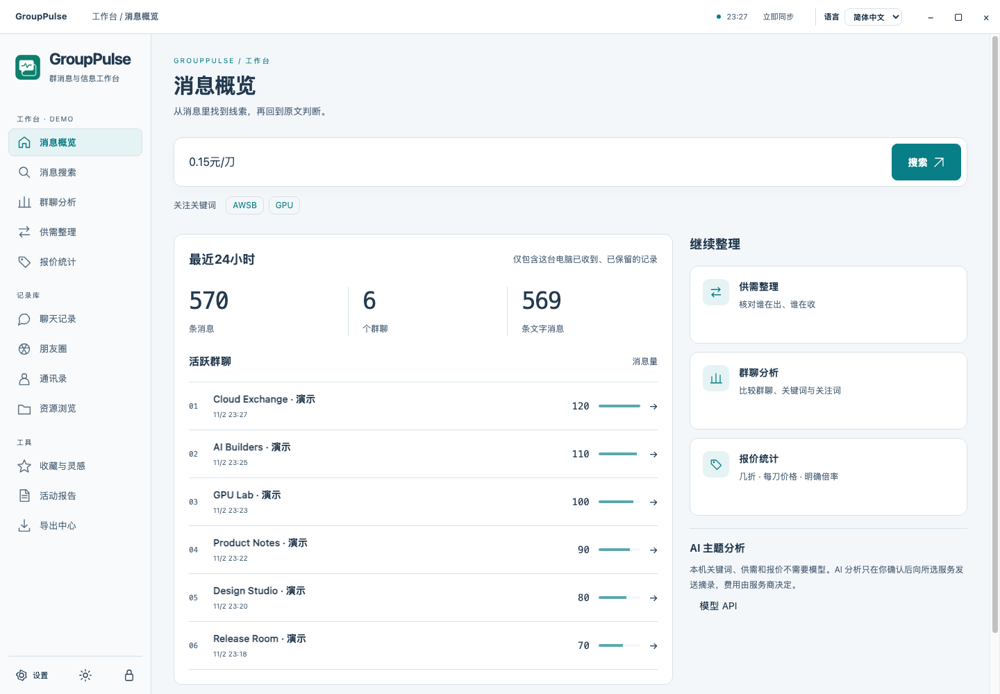
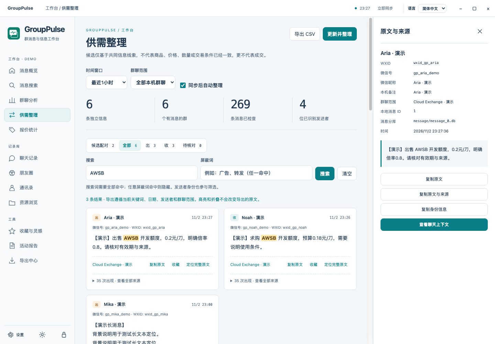
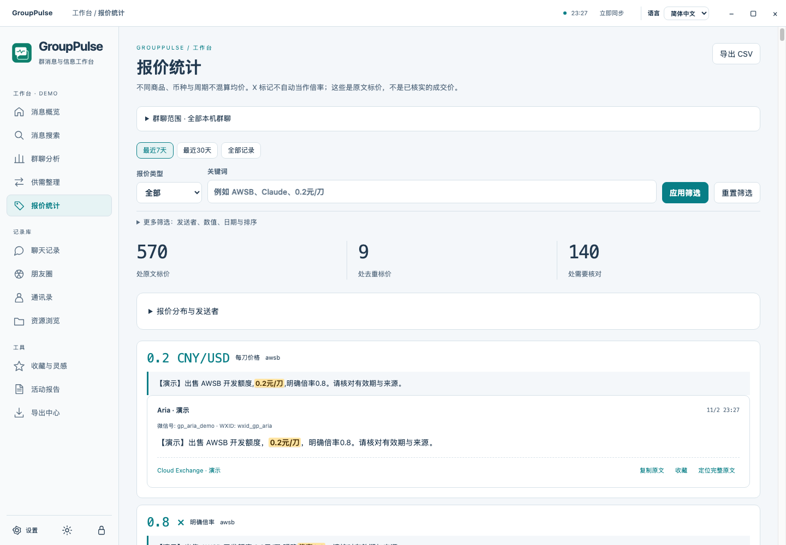
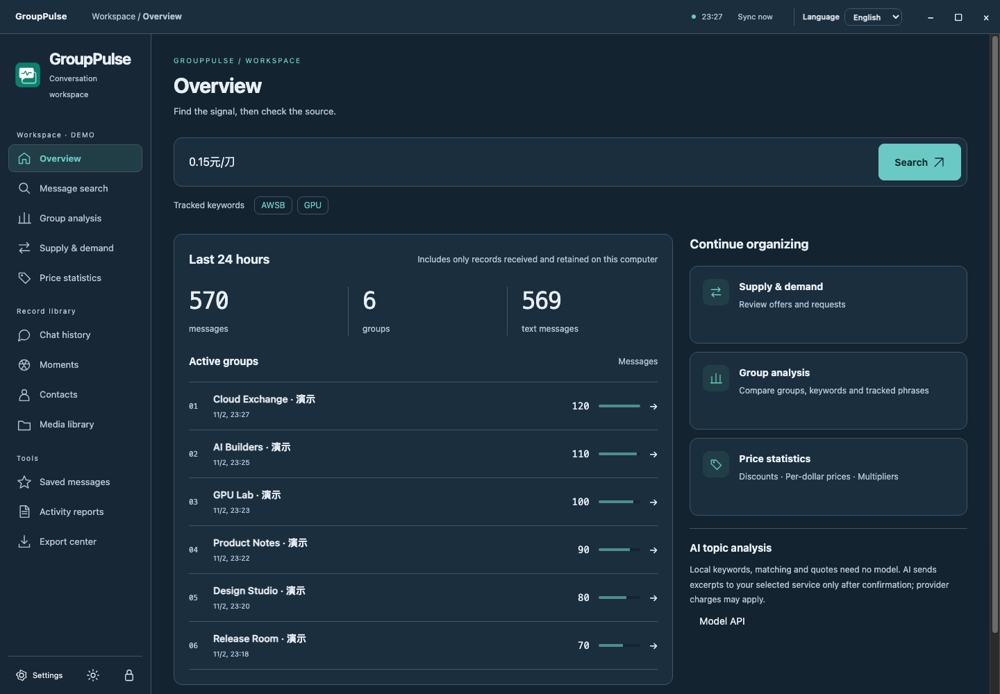

<p align="center"></p>

# GroupPulse

**把群聊里的信息，变成能搜索、能核对、能分析的线索。**

GroupPulse 是面向本机微信记录的独立桌面工作台。统一查看聊天、朋友圈、通讯录和资源；追踪关键词、整理供需、统计报价，再从任何结果回到发送者与完整原文。基础整理在本机完成，AI 分析可接你自己的模型 API。

[下载 macOS / Windows 版本](https://github.com/cyf1124906008-ai/GroupPulse/releases/latest) · [使用说明](docs/USER_GUIDE.zh-CN.md) · [功能与边界](docs/ARCHITECTURE.md) · [许可证](LICENSE)

**中文** · [English](docs/i18n/README.en.md) · [日本語](docs/i18n/README.ja.md) · [한국어](docs/i18n/README.ko.md) · [Deutsch](docs/i18n/README.de.md) · [Français](docs/i18n/README.fr.md) · [Español](docs/i18n/README.es.md) · [Português](docs/i18n/README.pt-BR.md)

软件界面支持**简体中文和英文**，可即时切换；上述其他语言提供项目介绍，不代表完整界面翻译。



## 用它做什么

| 你想知道 | GroupPulse 提供 |
| --- | --- |
| 哪些群最活跃？主要在聊什么？ | 群聊消息量排行、每日与小时分布、消息类型、本机词频，以及自定义短语的命中消息数、出现次数、群数和发送者数。 |
| 某个关键词在哪里出现过？ | 聊天、朋友圈和通讯录搜索；明显的搜索按钮与回车提交；命中高亮；长消息优先展示命中的句子。 |
| 谁在出，谁在收？ | 按 1 / 3 / 6 / 24 小时窗口整理供给、需求、待核对信息与候选配对。按发送者和正文合并重复信息，保留每一次来源。 |
| 多少折、多少钱一刀、多少倍率？ | 分别提取折扣、CNY/USD 单价、明确倍率、套餐档位与金额周期。不同商品、币种、单位分别统计；模糊表达标为待核对。 |
| 这句话是谁发的？ | 显示本地保留的昵称、备注、微信号、WXID、时间和群名，定位完整原文、消息分库与上下文。不按相同昵称合并身份。 |
| 想让 AI 进一步归纳？ | 自填服务地址、模型和 API Key。支持 OpenAI 兼容、Responses、Anthropic、Google 接口；发送前先检查范围与目标，再明确确认。 |
| 想留存结果？ | 收藏消息，按筛选导出 CSV / JSON，导出年度 HTML 活动报告。导出包含全部匹配记录，不限于屏幕第一页。 |

### 供需与报价工作台

搜索词按“全部命中”组合，屏蔽词按“任一命中”排除；配对任一侧被屏蔽时整对隐藏。相同人的重复发言合并展示，不同人的同文信息保持独立。配对只是共同商品和词语的候选线索，不代表交易撮合成功。



“20x”可以是套餐标记，并不自动当作明确倍率；“¥120/月”和“¥120/天”分开；标价不等于成交价。每个数字都保留原句和发送者，便于核对。



### 记录库与可读界面

清晰均衡的导航、按需展开的身份面板、中英文即时切换和浅色 / 深色主题。聊天保留上下文；朋友圈读取本机已缓存记录；头像、普通图片、DAT 图片、SILK 语音、MP4 与 WXGF 首帧通过独立媒体读取层处理。




以上截图全部使用仓库生成的**合成演示数据**，没有真实群成员、真实聊天或真实 API Key。

## 安装与打开

- **macOS Apple Silicon**：下载 `GroupPulse-2.0.0-macOS-arm64.zip`，解压后把 `GroupPulse.app` 放到“应用程序”再打开。当前包为本地签名，未做 Apple 公证；首次可能需要你在系统设置中手动允许打开。Intel Mac 暂不提供成品包。
- **Windows x64**：下载 `GroupPulse-2.0.0-Windows-x64.zip`，完整解压，运行 `GroupPulse/GroupPulse.exe`。不要单独移动 exe。当前无商业代码签名，系统可能显示未知发布者提示。
- 发布页附 SHA-256、构建信息和原生测试报告。验证范围见 [VALIDATION.md](docs/VALIDATION.md)。

首次选择微信 4.x 账号目录（含 `db_storage`）或完整的明文数据库副本（含 `session`、`contact`、`message`）。加密数据需要本机验证通过的数据库密钥。Mac 提供需本人确认登录的临时副本初始化；Windows 可导入本人账号保存的 ChatTrace `.keyinfo`，或手动填写有效密钥。

旧版本的明文数据库可以作为数据源选择，**不会复制旧程序代码或复用旧钥匙串身份**。如果只导入静态明文副本，内容只更新到该副本的时间；要持续同步，需要选择仍在更新的原账号数据并提供有效密钥。图片缺失时，在设置中指定对应账号的原始媒体目录。

## 本机数据与 AI

- 原始数据库只读；生成独立快照与索引，不修改微信数据库。自动同步每分钟检查本机变化，不从服务器补拉历史消息或朋友圈。
- 启动、切换页面和语言不主动读取系统密钥。手动解锁 / 同步、保存密钥或明确请求模型时才按需使用系统保护存储。新系统身份为 `GroupPulse`；签名变化仍可能触发 macOS 自身的访问确认。
- 默认不下载远程媒体；可在设置中允许访问固定腾讯媒体域名。失效链接、未缓存内容、撤回或已删除资源无法保证恢复；WXGF 当前显示首帧。
- 本机词频、供需和报价不需要模型 API。AI 每次最多发送 60 条摘录，每条至多 1,000 字符，并显示发送目标、样本数和范围。取消不联网、不读取模型密钥。第三方模型服务可能计费。
- 应用锁保护界面访问，不代替磁盘加密。索引、解密副本、导出文件和媒体缓存包含私人资料，应由你妥善保管。

## 源码与构建

应用代码、界面和索引独立构建，无需旧程序安装包。运行时只取官方 Electron；媒体组件分别验证来源、保留许可。

```sh
# Node.js 24.17+（24.x）、Python 3.9+；macOS 需要 Xcode Command Line Tools
node --test tests/*.test.cjs
python3 scripts/audit.py
python3 scripts/build.py --platform macos
python3 scripts/run-native-tests.py --platform macos
python3 scripts/package.py --platform macos
```

Windows 的原生构建流程、合成演示和目录说明见 [开发文档](docs/ARCHITECTURE.md)。GitHub Actions 在独立 Mac / Windows runner 上构建并运行原生测试，不读取你的本机记录、模型配置或密钥。

## 非商业许可

GroupPulse 项目代码按 **[PolyForm Noncommercial 1.0.0](LICENSE)** 公开：可在许可范围内非商业使用、修改、分享；商业使用须另行取得适当授权。准确称谓为**公开源码、非商业使用**，不是 OSI 认证开源许可。第三方独立组件继续适用自己的 MIT、BSD、LGPL 等许可，详见 [NOTICE.md](NOTICE.md)。

软件不提供微信服务器账号访问能力，不保证本机未保留的记录可恢复；也不代表腾讯或任何模型服务商的官方产品。反馈时请先遮盖真实聊天、账号和密钥。
