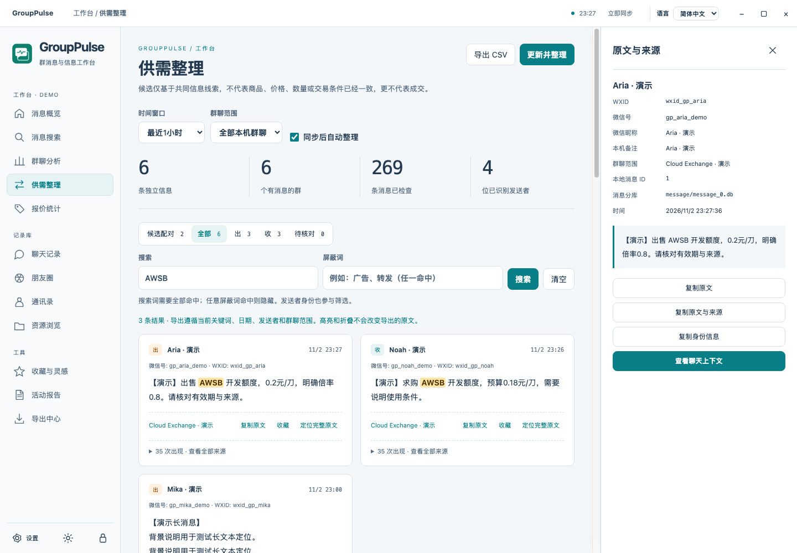
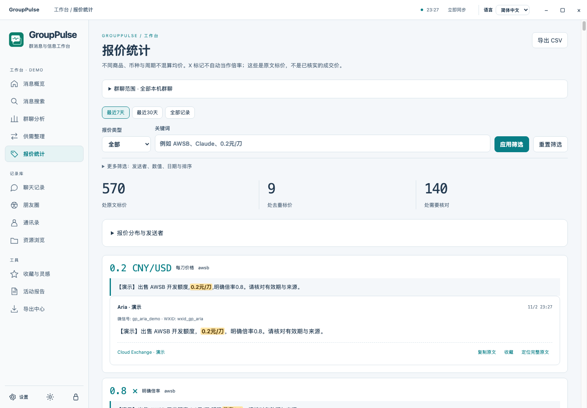

# GroupPulse

**Make group conversations searchable, traceable and useful.**

[中文](../../README.md) · English · [日本語](README.ja.md) · [한국어](README.ko.md) · [Deutsch](README.de.md) · [Français](README.fr.md) · [Español](README.es.md) · [Português](README.pt-BR.md)

GroupPulse is an independent desktop workspace for local WeChat 4.x records. Search chats, Moments and contacts; track phrases, organize supply and demand, compare posted prices and return to the exact sender and original message. The interface supports **Simplified Chinese and English**, with instant switching and light/dark themes. The other languages here are project introductions.

## Features

- **Search with evidence:** visible search buttons, Enter submission, highlighted hits and long-message snippets centered on the matching sentences. Filter conversations, dates and senders; open the full original and neighboring messages.
- **Local analysis:** conversation activity, daily/hourly distributions, message types, word frequency and custom phrase counts. Occurrences, matching messages, groups and identifiable senders are counted separately.
- **Supply and demand:** 1/3/6/24-hour windows, offer/request/review categories and candidate pairs. Deduplicate by sender ID and normalized body while keeping every source. All search terms must match; any blocked term excludes a listing or an entire pair.
- **Price evidence:** discounts, CNY per USD, explicit multipliers, plan labels and amounts per period remain separate. “20x” is not automatically a multiplier. Posted prices are not confirmed transactions.
- **Records and media:** local chats, cached Moments, contacts, avatars, DAT images, SILK audio, MP4 and WXGF first-frame previews. Missing/deleted/uncached content is not guaranteed recoverable.
- **Optional AI:** configure your own OpenAI-compatible, Responses, Anthropic or Google service. Preview the destination and up to 60 excerpts of at most 1,000 characters each; explicitly confirm before sending. Provider charges may apply. Canceling sends nothing and reads no model key.
- **Keep results:** bookmarks, complete filtered CSV/JSON exports and standalone yearly HTML activity reports. Export is not limited to the first visible page.

## Install and import

Download the appropriate archive from [Releases](https://github.com/cyf1124906008-ai/GroupPulse/releases/latest). macOS packages target Apple Silicon; Windows packages target x64. Extract everything. On Mac move GroupPulse.app to Applications; on Windows run GroupPulse/GroupPulse.exe. These packages do not have commercial code-signing/notarization; the OS may require manual approval.

Choose a local account folder containing db_storage, or a complete plaintext copy containing session, contact and message folders. Encrypted databases require a valid local key. Mac initialization uses an explicitly approved temporary login copy and needs your own login confirmation. Windows can import a ChatTrace .keyinfo file protected by the same Windows user's DPAPI, or accept a valid key manually. A static plaintext copy only updates when that copy changes. Select the original media directory if you imported databases separately.

Original databases stay readonly. A private snapshot and index are built under the OS application data folder named GroupPulse. Automatic sync checks local changes every minute; it does not fetch server history. Old profile secrets are not silently migrated. Startup, navigation and language switching do not proactively read system credentials. An app lock protects the interface, not plaintext files on disk.

All screenshots and CI tests use synthetic data. For exact platform checks and limits see [Validation](../VALIDATION.md). Build instructions and independent architecture are in [Architecture](../ARCHITECTURE.md).

## License

Project code is **source available under [PolyForm Noncommercial 1.0.0](../../LICENSE)**: permitted noncommercial use, modification and sharing. Commercial use needs appropriate separate permission. A noncommercial restriction is not an OSI open-source license. Third-party components retain their own MIT/BSD/LGPL licenses; see [Notices](../../NOTICE.md). Independent FFmpeg source and exact build flags accompany distributions.

Do not upload private databases, API keys or unredacted screenshots to issues. GroupPulse is not an official Tencent or model-provider product.
