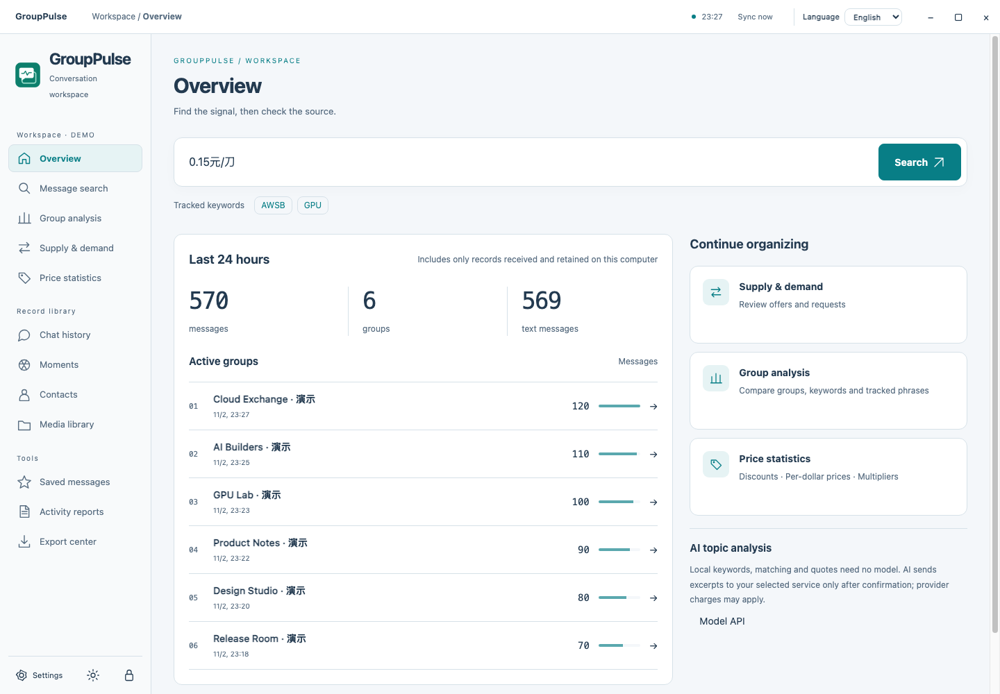

# GroupPulse

**그룹 대화를 검색하고, 출처를 확인하고, 필요한 정보를 정리하세요.**

[中文](../../README.md) · [English](README.en.md) · 한국어

GroupPulse는 컴퓨터에 저장된 WeChat 4.x 기록을 위한 독립 데스크톱 작업 공간입니다. 채팅, 모멘트, 연락처를 검색하고 키워드 빈도, 공급·수요, 게시된 가격을 살펴볼 수 있습니다. 각 결과에서 발신자, 원문과 앞뒤 대화로 이동할 수 있습니다.

## 주요 기능

- 검색 버튼과 Enter 제출, 검색어 강조, 긴 메시지의 일치 문장 우선 표시.
- 그룹별 메시지 수, 날짜·시간 분포, 단어 빈도 및 사용자 지정 키워드 집계.
- 최근 1/3/6/24시간의 공급·수요 정리. 같은 발신자의 중복 게시물은 합치되 모든 출처를 보존합니다. 후보 연결은 거래 성사를 뜻하지 않습니다.
- 할인, CNY/USD 단가, 명시적 배율, 요금제 표시, 기간별 금액을 구분하는 가격 분석.
- 로컬 이미지·아바타·SILK 음성·MP4 및 WXGF 첫 프레임. 저장되지 않거나 삭제된 자료의 복구는 보장하지 않습니다.
- 사용자 모델 API를 이용하는 선택적 AI 분석. 대상과 발췌 범위를 확인한 후 전송하며 제공업체 비용이 발생할 수 있습니다.
- 필터를 반영한 전체 CSV/JSON 내보내기, HTML 연간 보고서, 북마크.

## 설치와 범위

[릴리스](https://github.com/cyf1124906008-ai/GroupPulse/releases/latest)에서 macOS Apple Silicon 또는 Windows x64 압축 파일을 받아 모두 푸세요. Mac에서는 GroupPulse.app, Windows에서는 GroupPulse/GroupPulse.exe를 실행합니다. 로컬 계정 폴더 또는 완전한 평문 데이터 사본을 선택하세요. 암호화된 데이터에는 유효한 로컬 키가 필요합니다.

원본 데이터베이스는 읽기 전용입니다. 정적 사본이 서버 기록을 자동으로 가져오지는 않습니다. 인터페이스는 **중국어 간체와 영어**를 지원하며 한국어 UI는 제공하지 않습니다. 화면 이미지는 합성 데모입니다.

프로젝트 코드는 [PolyForm Noncommercial 1.0.0](../../LICENSE)에 따라 소스가 공개됩니다. 허용 범위에서 비상업적 사용·수정·공유가 가능하며 상업적 사용에는 별도 권한이 필요합니다. 비상업적 제한은 OSI 오픈소스 라이선스가 아닙니다. 독립 구성 요소의 라이선스는 [NOTICE](../../NOTICE.md)를 확인하세요.
